# Penetration Testing Report
### Footprinting & Network Scanning Phases | W2-PM-FINAL | Networkwalks

| | |
|---|---|
| **Pentester Name** | Isa Al Daaysi |
| **Program/Batch** | B084 - Networkwalks |
| **Date** | 9 November 2026 |
| **Modules completed** | W2-PM1 (Footprinting with multiple Kali tools) W2-PM3 (Footprinting with Maltego) W2-PM4 (Footprinting with theHarvester) W2-PM5 (Network scanning with Zenmap) |
| **Client/Target** | 1. Networkwalks - networkwalks.com (written permission secured) 2. My own home LAN - 192.168.100.0/24 3. microsoft.com (W2-PM4 only - passive OSINT through public third-party sources, no direct contact with Microsoft systems) |
| **Permission secured from client?** | Yes (Networkwalks and my own network) |
| **Phases covered** | Phase 1: Reconnaissance & Footprinting Phase 2: Scanning & Network Discovery Phase 3-5: In progress |

---

## 1. Liability Disclaimer

I performed these activities only against systems I had written permission to test (networkwalks.com) or that I own myself (my home network). The theHarvester module used only public search sources and databases, and did not send any traffic to the target organisation. Everything in this report is for education and research. Unauthorised scanning or access is illegal in most countries even when nothing is damaged, and I take full responsibility for my own actions.

## 2. Introduction

This report shows what I did for the 2nd week of my cybersecurity internship at Networkwalks. I did 4 modules: footprinting networkwalks.com with the use of 6 Kali tools (W2-PM1), then the same with Maltego (W2-PM3), then with theHarvester (W2-PM4), then scanning my own house network with Zenmap (W2-PM5). All of that covers the first two phases of a pen test: gathering information about the target, then discovering the live devices on a given network.

The Kali tools were used inside a Kali Linux 2026.3 virtual machine. Maltego and Zenmap were used on my Windows laptop. I saved the command output as a text file and took a screenshot for every step, and they’re listed in section 9, Evidence.

**Note on W2-PM2 (GHDB):** I did not select this elective. Its first task involves opening live security cameras that belong to third parties, which falls outside the authorised scope (networkwalks.com and my own LAN only).

## 3. Tools Used

| Tool | Purpose |
|---|---|
| Kali Linux 2026.3 & Windows 11 | Operating systems used for the activities |
| whois | Find domain registration details (registrar, dates, name servers) |
| whatweb | Fingerprint web technologies (server, CMS, plugins, versions, IP) |
| nslookup | Resolve the domain name to its IP address |
| curl -I | Read the HTTP response headers of the website |
| wafw00f | Detect whether a Web Application Firewall protects the site |
| dnsrecon | Enumerate DNS records (SOA, NS, MX, A, TXT/SPF, SRV) |
| Maltego Graph 4.14.0 | Graph-based OSINT; run transforms to find email addresses linked to a domain |
| theHarvester 4.11.1 | Collect emails, hosts, IPs and ASNs from public sources |
| Nmap / Zenmap 7.993 | Scan the local subnet to find live hosts, IPs and MAC addresses |
| Windows CMD / PowerShell | ipconfig, ping, arp and Get-NetIPAddress to confirm local addressing |

## 4. Activities Performed

### 4.1 Footprinting with multiple Kali tools (W2-PM1)

I footprinted **networkwalks.com** with six built-in Kali tools, saving each output with `tee` so the screen output and a text file were captured at the same time.

- **WHOIS:** the domain is registered with GoDaddy.com, LLC. It was created on 6 November 2019 and expires on 6 November 2027. The owner's details are hidden by Domains By Proxy (privacy protection), the name servers are on HostGator (NS6135/NS6136.HOSTGATOR.COM) and DNSSEC is unsigned. The domain is locked against transfer, update and deletion.
- **WhatWeb:** the site runs WordPress 7.1.4 with the WP Download Manager 3.3.76 plugin, jQuery 3.7.1 and Bootstrap on an Apache server. HTTP redirects to HTTPS with a 301. It also exposed the IP 192.232.216.135 and the contact email info@networkwalks.com. These versions are newer than the ones in the lab guide, which shows the site has been updated since.
- **Nslookup:** the domain resolves to 192.232.216.135 (a non-authoritative answer from Google DNS, 8.8.8.8).
- **Curl -I:** the server answered HTTP/2 200 with `server: Apache`. The headers expose the WordPress REST API (`/wp-json/`). The session cookie is set with Secure and HttpOnly, which is good, but the common security headers (Strict-Transport-Security, Content-Security-Policy, X-Frame-Options and X-Content-Type-Options) were not present.
- **Wafw00f:** the site is behind the ModSecurity (SpiderLabs) Web Application Firewall.
- **DNSRecon:** found 8 records. The name servers are on HostGator, and both of them disclose their BIND version (9.16.23-RH). The mail server mail.networkwalks.com uses the same IP as the website. The SPF record ends in ~all (soft fail), there is a Google site-verification TXT record, and cPanel autodiscover SRV records show the site is hosted on cPanel. There was no answer to the DNSSEC query.

### 4.2 Footprinting with Maltego (W2-PM3)

I installed Maltego Graph (Desktop) 4.14.0, which also installed its Java runtime, created a free Maltego ID and activated the community licence. I placed a Domain entity on a new graph, set it to networkwalks.com and ran the email transforms (To Email address [From whois info] and To Email Addresses [Search Engine]).

Maltego returned two email addresses:

- **info@networkwalks.com** - the organisation's own contact address. WhatWeb found the same address in W2-PM1, so two separate tools confirm this finding.
- **abuse@godaddy.com** - the registrar's abuse contact from the WHOIS record. It belongs to GoDaddy, not Networkwalks staff, so it is not a target for social engineering.

The transforms used 10 of the 200 monthly credits on the free account.

### 4.3 Footprinting with theHarvester (W2-PM4)

**Task 1:** `theHarvester -d microsoft.com -l 1000 -b baidu` returned no IPs, emails, people or hosts. Baidu limits automated scraping and the lab guide warns that results change over time, so I ran a broader search for Task 2.

**Task 2:** `theHarvester -d microsoft.com -l 50 -b all` found:

- 9,968 hosts/subdomains, 53 IP addresses and 7 ASNs
- 3 interesting URLs
- 3 email addresses: secure@microsoft.com, opencode@microsoft.com and dotnet-docker-bot@microsoft.com
- No LinkedIn users or people

About 30 of the sources were skipped because they need an API key (for example Shodan, Hunter, VirusTotal, Censys and SecurityTrails), so a run with registered API keys would return more. The Hudson Rock source also reported aggregate statistics of 621,624 compromised credentials linked to the domain (16,598 employees and 600,241 users) from infostealer malware logs. I only saw the totals, not any credentials.

### 4.4 Network scanning with Zenmap (W2-PM5)

I installed Nmap/Zenmap 7.993 from nmap.org together with Npcap 1.90. Running `ipconfig /all` showed my PC is connected by Ethernet with the IP 192.168.100.222, subnet mask 255.255.255.0 (192.168.100.0/24), and the router 192.168.100.1 as gateway and DHCP server. I ignored the VirtualBox host-only adapters (192.168.56.1 and a 169.254.x.x address).

A Ping Scan (`nmap -sn 192.168.100.0/24`) scanned 256 addresses in 4.33 seconds and found 10 live hosts. To protect my household's privacy I have masked the last three bytes of each MAC address. The first three bytes still identify the manufacturer.

| IP address | MAC address | Vendor / device |
|---|---|---|
| 192.168.100.1 | 2C:97:B1:xx:xx:xx | Huawei - home router / gateway |
| 192.168.100.3 | E0:8F:4C:xx:xx:xx | Intel - a PC or laptop |
| 192.168.100.44 | BA:75:72:xx:xx:xx | Randomised (private) MAC - likely a phone or tablet |
| 192.168.100.61 | 52:C3:14:xx:xx:xx | Randomised (private) MAC |
| 192.168.100.63 | 5E:A2:A0:xx:xx:xx | Randomised (private) MAC |
| 192.168.100.67 | B6:A5:72:xx:xx:xx | Randomised (private) MAC |
| 192.168.100.121 | B6:42:CD:xx:xx:xx | Randomised (private) MAC |
| 192.168.100.129 | A4:6D:A4:xx:xx:xx | Huawei - another Huawei device |
| 192.168.100.221 | E8:B0:C5:xx:xx:xx | My own PC - Wi-Fi adapter |
| 192.168.100.222 | 60:CF:84:xx:xx:xx | My own PC - Ethernet adapter |

Five MAC addresses showed as Unknown. Their second hex digit is 2, 6, A or E, which marks them as locally administered: these are the randomised private addresses that modern phones use on Wi-Fi so they cannot be tracked. That is why Nmap could not name a vendor.

Zenmap showed 192.168.100.221 with no MAC address. I investigated it: it answered ping in under 1 ms with TTL 128 (a Windows host) and was not in the ARP table, and `Get-NetIPAddress` in PowerShell confirmed it is my own PC's Wi-Fi adapter. My PC was connected by both Ethernet and Wi-Fi, so it appeared twice. Finally I opened the Topology tab, enabled the legend and saved the topology as a PDF.

## 5. Risk Analysis / Impact

Based on the information collected, I identified the following potential risks for networkwalks.com and my own network.

| # | Risk / Finding | Evidence / Observation | Potential Impact | Risk Level |
|---|---|---|---|---|
| 1 | Missing HTTP security headers | curl -I: no HSTS, CSP, X-Frame-Options or X-Content-Type-Options | Weaker protection against clickjacking, content injection and HTTPS downgrade | 🟠 Medium |
| 2 | Exact software versions exposed | WhatWeb: WordPress 7.1.4, WP Download Manager 3.3.76, jQuery 3.7.1 | Attackers can match the versions against known vulnerabilities | 🟠 Medium |
| 3 | DNS server version disclosed | DNSRecon: BIND 9.16.23-RH on both name servers | Helps attackers target known flaws in that DNS software version | 🟠 Medium |
| 4 | Public contact email exposed | WhatWeb and Maltego: info@networkwalks.com | Target for phishing and social engineering | 🟡 Low |
| 5 | WordPress REST API exposed | curl -I: /wp-json/ link header | Can be used to enumerate content and possibly user names | 🟡 Low |
| 6 | DNSSEC not enabled | WHOIS: DNSSEC unsigned; DNSRecon: no DNSSEC answer | DNS answers cannot be verified, so spoofing is harder to detect | 🟡 Low |
| 7 | SPF soft fail (~all) | DNSRecon TXT record | Spoofed emails may be marked rather than rejected | 🟡 Low |
| 8 | Web and mail on one IP | DNSRecon/nslookup: both on 192.232.216.135 | An attack or outage on one server affects both services | 🟡 Low |
| 9 | Large public footprint and leaked credentials (microsoft.com) | theHarvester: 9,968 hosts; Hudson Rock totals | More entry points; stolen credentials can be reused against accounts | 🔵 Info |
| 10 | Hard-to-identify devices on home LAN | Zenmap: 5 randomised MACs | Unknown devices are harder to inventory and verify | 🟡 Low |

**Positive findings:** WHOIS privacy is enabled, a WAF (ModSecurity) protects the site, HTTP redirects to HTTPS, the session cookie uses Secure and HttpOnly, and the domain is locked against transfer and deletion.

> These are observations from footprinting and scanning, not confirmed vulnerabilities. No exploitation or vulnerability validation was performed, and further authorised testing would be needed to confirm any real weakness.

## 6. Recommendations

1. **Add HTTP security headers.** Configure Strict-Transport-Security, Content-Security-Policy, X-Frame-Options and X-Content-Type-Options on the web server.
2. **Hide version information and keep software updated.** Remove the WordPress generator tag and plugin version strings, and keep WordPress, plugins and jQuery on the latest releases.
3. **Hide the BIND version.** Ask the hosting provider to hide the DNS server version and confirm it runs a supported BIND release.
4. **Enable DNSSEC.** Sign the zone through the registrar or DNS host so DNS answers can be verified.
5. **Tighten email authentication.** Change SPF from ~all to -all once all legitimate senders are listed, and publish a DMARC policy.
6. **Restrict the REST API.** Limit sensitive endpoints such as /wp-json/wp/v2/users to logged-in users.
7. **Reduce exposed contact details.** Use a contact form or a filtered role address, and train staff to recognise phishing.
8. **Keep the WAF tuned and monitored.** ModSecurity already blocks basic attacks; review its rules and logs regularly.
9. **Keep a device inventory at home.** Compare the router's DHCP client list with known devices and investigate anything unexpected.
10. **Monitor credential exposure (large organisations).** Watch infostealer and breach sources, enforce MFA and reset any exposed credentials.
11. **Only test with authorisation.** Reconnaissance and scanning should only be done against systems in a written scope.

## 7. Challenges & How I Solved Them

- **Wrong terminal:** I first ran whatweb in Git Bash on Windows and got "command not found". I learned to tell the Windows host and the Kali VM apart and ran all Kali tools inside the VM.
- **Saving output:** I piped every command through tee so the output was shown and saved at once, then copied the files to Windows through a VirtualBox shared folder. dnsrecon and parts of theHarvester write to stderr, so for those I relied on screenshots or re-ran the command with 2>&1.
- **No results from Baidu:** the Baidu-only search returned nothing, so I ran the all-sources search to complete the task.
- **Missing API keys:** about 30 theHarvester sources need API keys. I noted this as a limitation instead of treating it as an error.
- **My PC appeared twice:** Zenmap showed an extra host with no MAC. I used ping, ARP and PowerShell to prove it was my own Wi-Fi adapter.
- **Installer off screen:** the Maltego Java installer opened partly outside my monitor, so I moved it back with Alt+Space and M.
- **Privacy:** I masked the last three bytes of all MAC addresses and redacted my public IPv6 addresses before adding screenshots to this report.

## 8. Conclusion

In Week 2 I completed four practical modules covering the first two phases of a penetration test. With the Kali tools I built a profile of networkwalks.com: who registered it, where it is hosted, what software it runs, which firewall protects it and what its DNS reveals. Maltego confirmed the organisation's public contact email, and theHarvester showed how much information about a large organisation can be collected from public sources alone, including a very large number of subdomains and leaked-credential statistics.

Zenmap showed me how quickly every device on a network can be mapped, and investigating the extra host taught me not to take a tool's output at face value but to verify it. The most useful lesson was that none of these tools attacked anything. They only read information that was already public or on my own network, which is why reconnaissance is so valuable to attackers and why defenders should run the same checks on themselves.

Finally, I learned that scope matters. I only tested targets I was authorised to test, and I protected the private details of devices on my network in this report.

## 9. Evidence Collected

**W2-PM1 - Footprinting with multiple Kali tools**

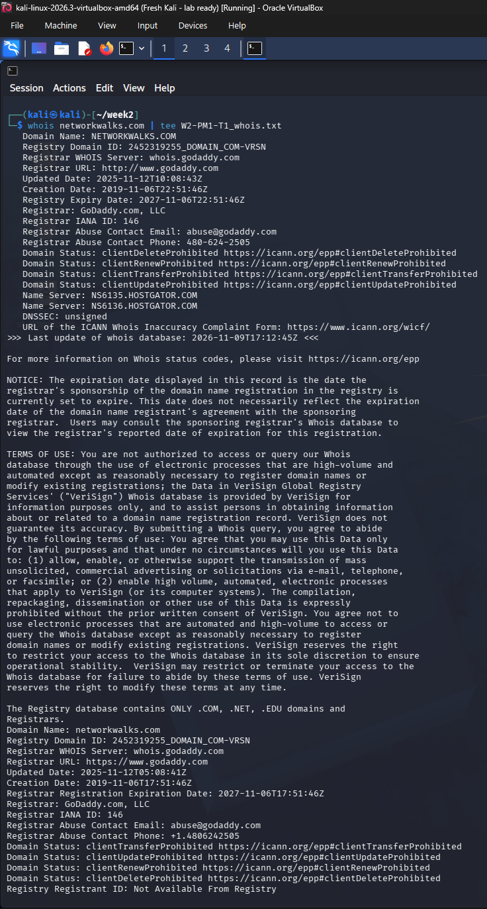
*Figure 1: whois networkwalks.com (part 1)*

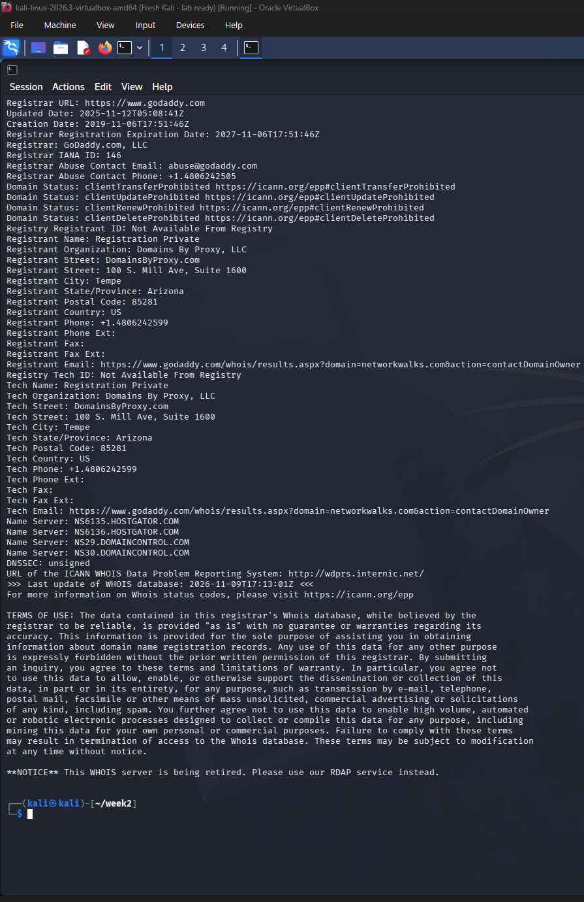
*Figure 2: whois networkwalks.com (part 2)*

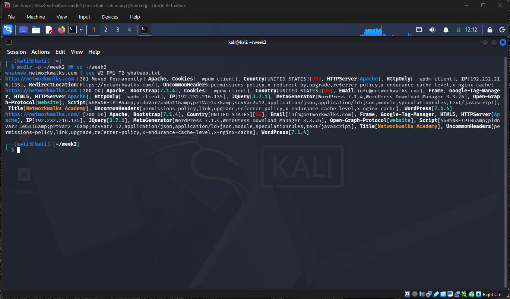
*Figure 3: whatweb networkwalks.com*

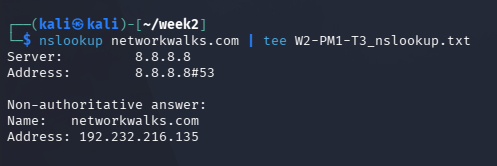
*Figure 4: nslookup networkwalks.com*

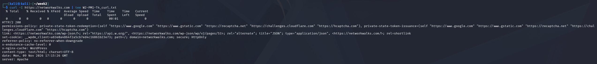
*Figure 5: curl -I https://networkwalks.com*

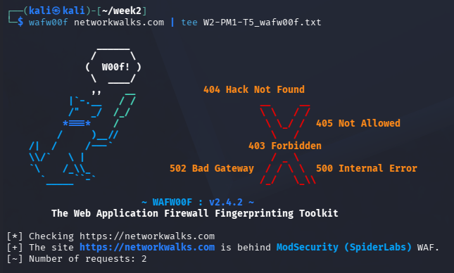
*Figure 6: wafw00f networkwalks.com*

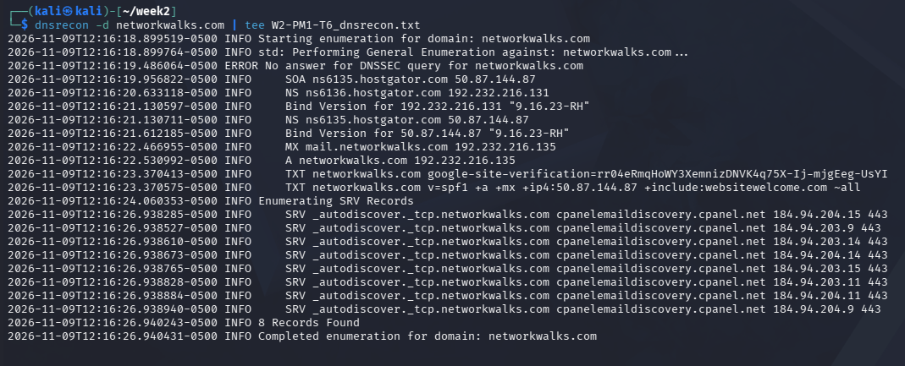
*Figure 7: dnsrecon -d networkwalks.com*

**W2-PM3 - Footprinting with Maltego**

*Figure 8: Maltego installed*

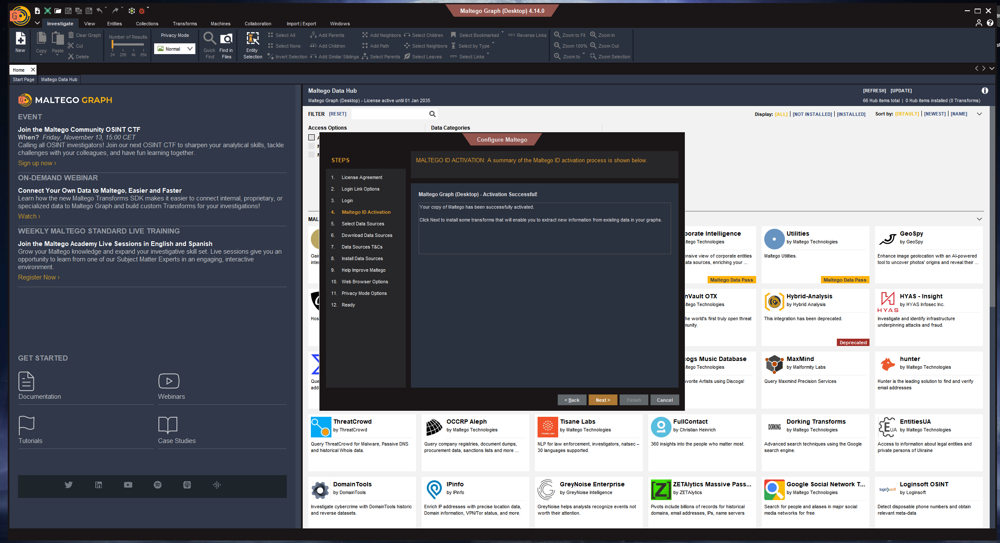
*Figure 9: Maltego ID activation successful*

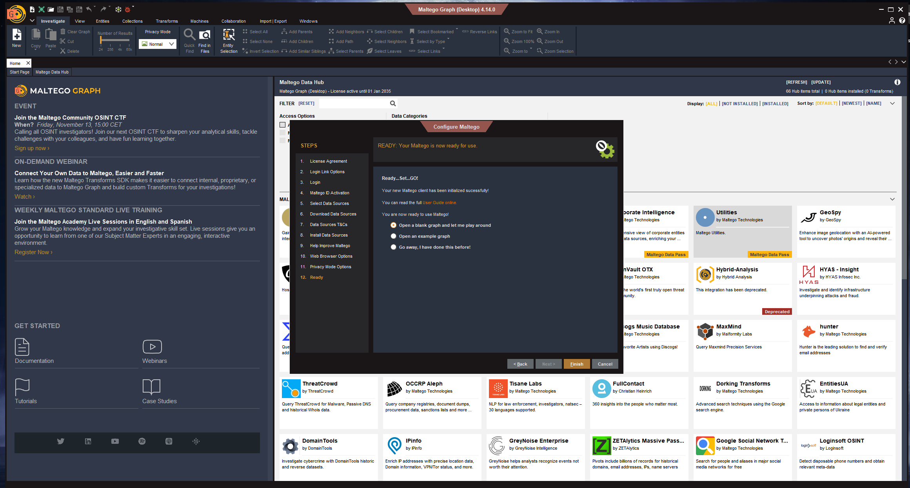
*Figure 10: Maltego setup complete*

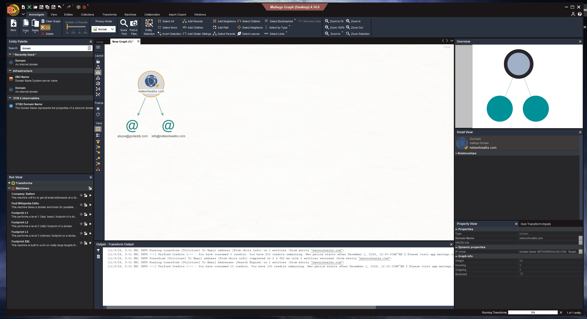
*Figure 11: Email addresses found for networkwalks.com*

**W2-PM4 - Footprinting with theHarvester**

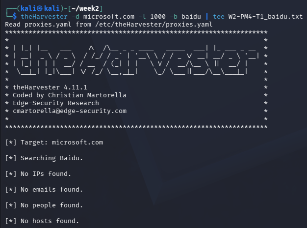
*Figure 12: theHarvester with Baidu (no results)*

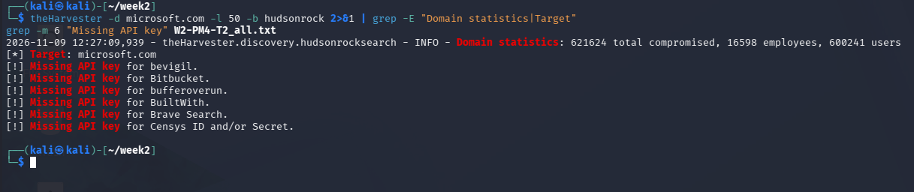
*Figure 13: Hudson Rock statistics and missing API keys*

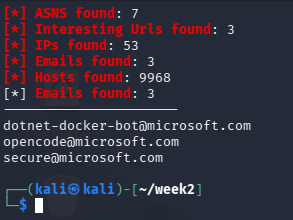
*Figure 14: Summary of results from all sources*

**W2-PM5 - Network scanning with Zenmap**

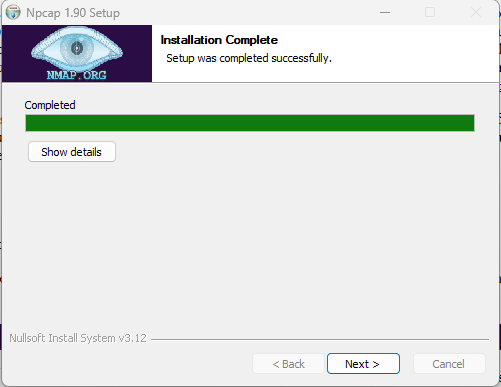
*Figure 15: Nmap/Zenmap installed*

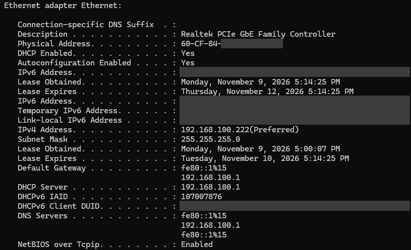
*Figure 16: ipconfig /all, Ethernet adapter (MAC, IPv6 and DUID redacted)*

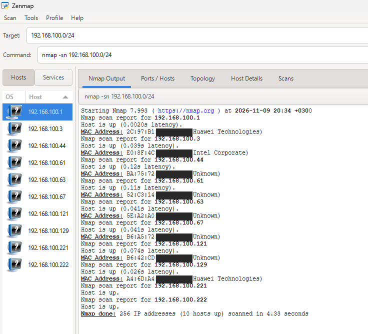
*Figure 17: Zenmap ping scan of 192.168.100.0/24 (MACs partly masked)*

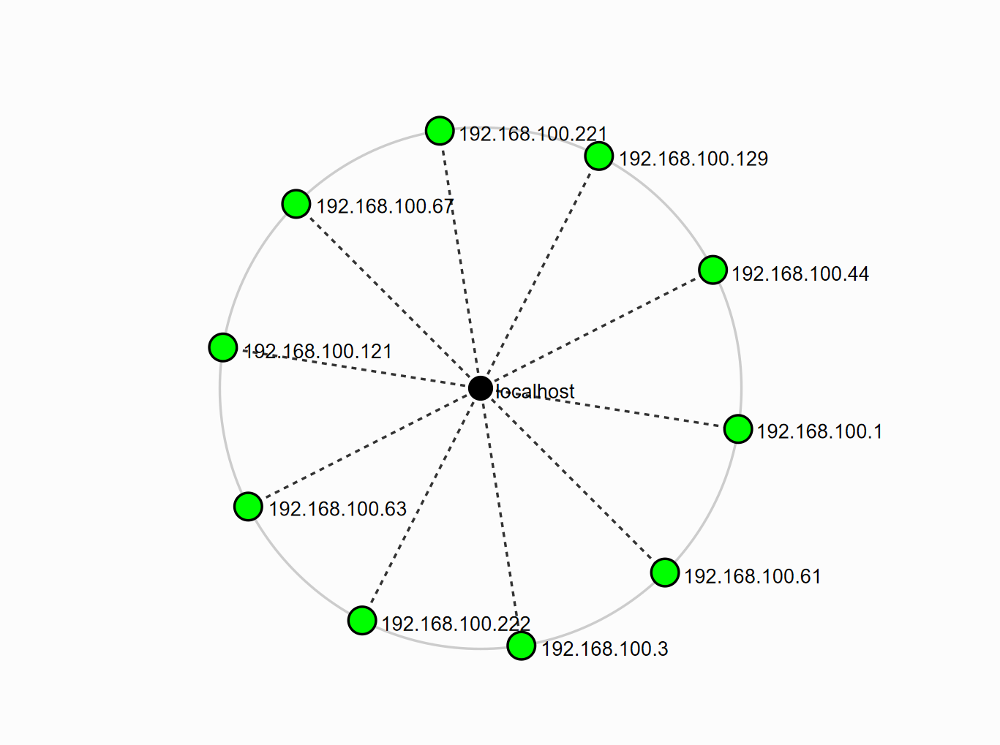
*Figure 18: Network topology*

<b>-End-</b>

---

**Author**

- Isa Al Daaysi - Cybersecurity Intern, Batch B084
- LinkedIn: https://www.linkedin.com/in/isa-al-daaysi/
- GitHub: [IDAC1899](https://github.com/IDAC1899)

**Project Information**

- Program: Cybersecurity program at Networkwalks
- Week: 02